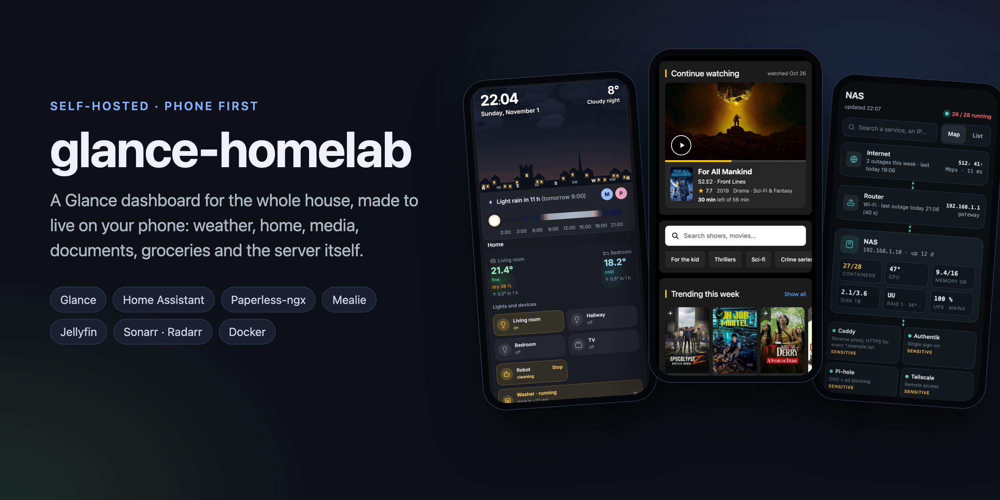
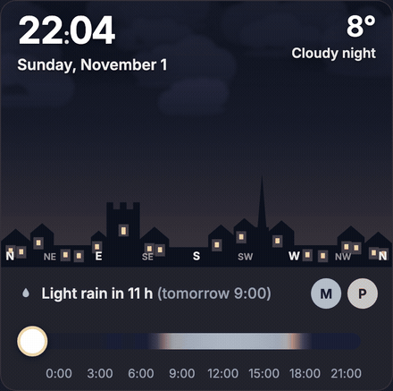
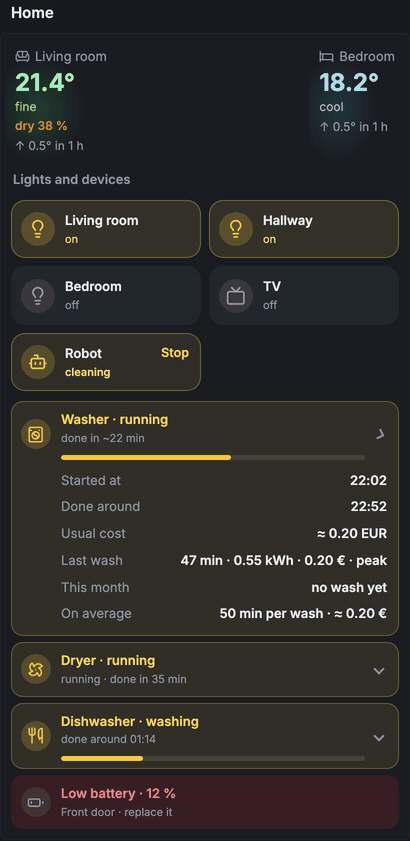
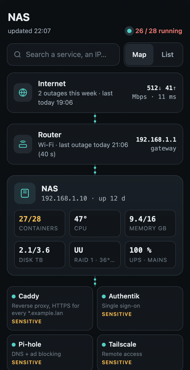
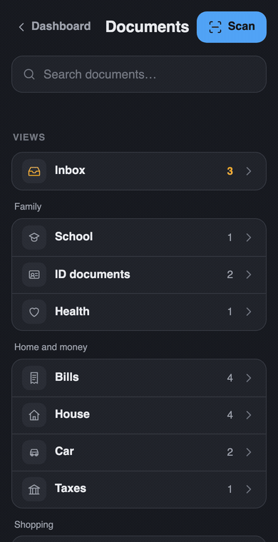
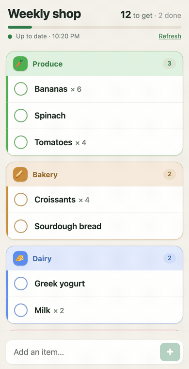
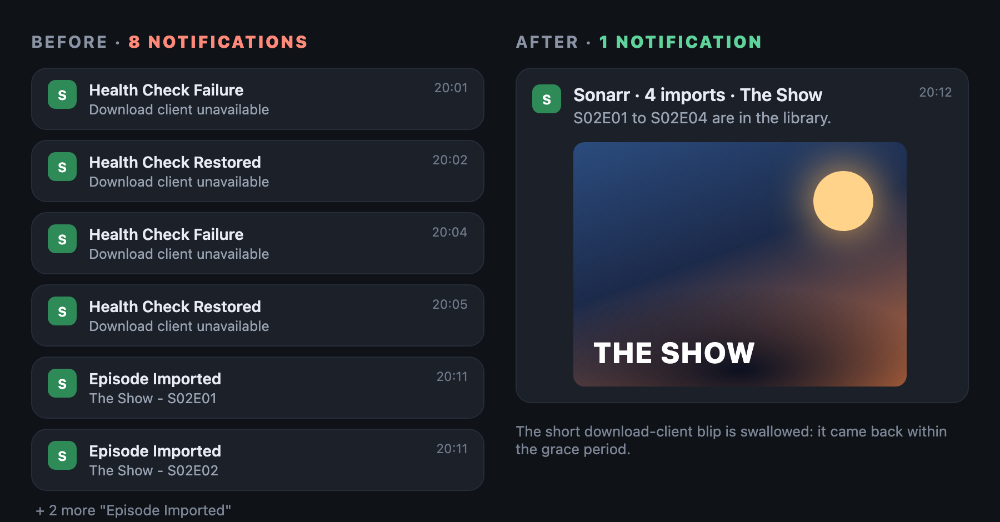
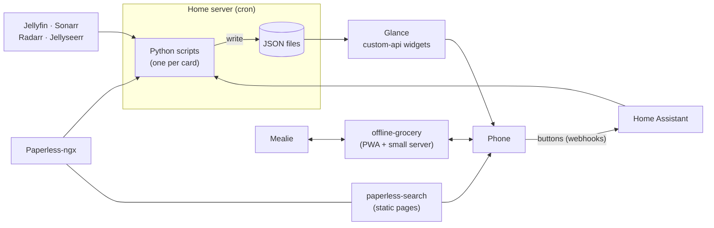

  

  A <a href="https://github.com/glanceapp/glance">Glance</a> dashboard for the whole house, made to live on your phone. 
  Weather, home, media, documents, groceries and the server itself, each one a module you can take on its own.

  <a href="#modules">Modules</a> ·
  <a href="#quick-start">Quick start</a> ·
  <a href="#how-it-fits-together">How it fits together</a> ·
  <a href="#faq">FAQ</a>

---

## Why

I wanted one screen that tells me everything about the house at a glance, and the screen I always have is my phone.
So this is a Glance setup built phone-first: open it in the morning, see the weather, what needs doing, what is
running, what is new to watch, and whether the server is fine. Every card is either useful right now or hidden.

It grew one annoyance at a time. Paperless search was clumsy on a phone, so documents got their own search page.
The Mealie shopping list would not load in the supermarket with no signal, so groceries got an offline app.
The Wi-Fi dropped and nobody could prove it, so the NAS page got an outage history. That is why the pieces are
separate modules: take the one that solves your annoyance and ignore the rest.

## Modules

<table>
  <tr>
    <td width="50%" valign="top">
       
      <h3><a href="dashboard">dashboard</a></h3>
      The <b>Home</b> and <b>Media</b> pages. An animated sky that follows the real sun, Moon and clouds, a to-do
      card with buttons, an agenda, Home Assistant tiles where the washer shakes while it runs, a meter readings form,
      and a Media page over Jellyfin, Sonarr, Radarr and Jellyseerr.
    </td>
    <td width="50%" valign="top">
       
      <h3><a href="dashboard#widgets">Home card</a></h3>
      Rooms, lights, robot vacuum, washer, dryer and dishwasher, with progress, end time and the cost of the last cycle.
      Buttons only show "✓" once Home Assistant actually answered.
    </td>
  </tr>
  <tr>
    <td width="50%" valign="top">
       
      <h3><a href="nas-tab">nas-tab</a></h3>
      A live, read-only status page for a Docker host: a map from internet to containers, things to fix, recent
      updates, Wi-Fi / internet / power outages over 30 days, and the scheduled tasks in the order they will run.
    </td>
    <td width="50%" valign="top">
       
      <h3><a href="paperless-search">paperless-search</a></h3>
      A phone-first search page for Paperless-ngx: type a word, see it highlighted, read the PDF. Plus "expiring soon",
      a two-tap inbox triage and a scan page. Static files, no token.
    </td>
  </tr>
  <tr>
    <td width="50%" valign="top">
       
      <h3><a href="offline-grocery">offline-grocery</a></h3>
      An installable app for your Mealie shopping list that keeps working with no signal. Check and add items
      offline, it syncs back when the network returns.
    </td>
    <td width="50%" valign="top">
       
      <h3><a href="arr-notify">arr-notify</a></h3>
      Calmer Sonarr / Radarr notifications on ntfy: a season becomes one message with the poster, and a download
      client that blinks for a minute no longer wakes you up.
    </td>
  </tr>
</table>

## Quick start

Each module has its own README with requirements, install steps and a configuration table. The short version:

1. **Pick a module** from the table above and open its folder.
2. **Copy the example config** (`config.example.env`, `config.example.js`…) and fill in your own URLs, entity ids and keys.
   Nothing in the code points at a specific house: everything site-specific lives in that file.
3. **Run it once by hand** (most scripts have `--print`, which shows the result without writing or sending anything),
   then add the cron line from `cron.example`.

If you only want the look, the theme and page styles are plain CSS in [`dashboard/assets`](dashboard/assets) and
[`nas-tab/assets`](nas-tab/assets).

## How it fits together

- **Scripts collect, Glance displays.** Every card reads a JSON file written by a small Python script (standard
  library only). Glance stays fast, and an API that is down never breaks the page.
- **The phone only talks to things you already run.** Buttons go to Home Assistant webhooks, the document pages use
  your normal Paperless login, the grocery app talks to Mealie through its own little server.
- **Read-only by default.** The NAS page shows, it does not restart or delete anything.

## FAQ

<b>Do I need everything (Home Assistant, Paperless, Mealie, the *arr apps)?</b>

No. Each module only needs its own service. The Home page needs Home Assistant; the Media page needs Jellyfin
and/or Sonarr/Radarr; paperless-search only needs Paperless; offline-grocery only needs Mealie; nas-tab only needs
Docker and cron.

<b>Will it work on my hardware?</b>

It runs on a UGREEN DXP2800 with around 50 containers, but nothing is specific to it: the NAS page reads Docker,
`/proc` and `/sys`, and everything else is HTTP APIs. Any Linux box that runs Docker and cron is fine.

<b>The interface is in English, can I translate it?</b>

Yes, the text lives in the Glance templates (`glance.example.yml`) and in the page scripts. The original setup was
in French; it was translated for this repo.

<b>Was this made with AI?</b>

Yes, with a lot of help from Claude: I described what I wanted and tested every change on my own server and phone,
Claude wrote most of the code. The ideas, the annoyances and the testing are mine. Use it, change it, and if
something is wrong, open an issue.

## License

[MIT](LICENSE). The icons in `dashboard/assets/icons.svg` come from [Lucide](https://lucide.dev) (ISC license).
