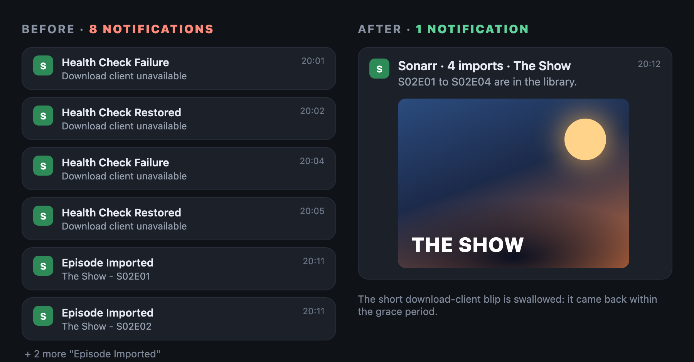

# arr-notify

Calmer Sonarr/Radarr notifications on [ntfy](https://ntfy.sh): bursts of imports become one message, short health
check blips are swallowed, and import notifications carry the movie or series poster.

<p align="center"></p>

## Why this exists

With Sonarr and Radarr sending straight to ntfy, the phone buzzed for every episode of a season and for every few
seconds the download client restarted. After a while you stop reading them, and then you miss the one that matters.
This script sits in between: it waits a moment, groups what belongs together, drops failures that fixed themselves,
and adds the poster so you can tell at a glance what arrived.

Before: six "Health Check Failure / Restored" in ten minutes because the download client restarted, and four
"Import Complete" for one season. After: nothing for the blip, one "Sonarr - 4 imports · The Show" with the poster.

## Requirements

- Sonarr v3+/v4 and/or Radarr v3+ with an ntfy connection.
- An ntfy server (self-hosted or ntfy.sh).
- Python 3.9+ on any machine that can reach ntfy and the *arr APIs, run from cron. No extra packages.

## Install

1. In Sonarr and Radarr, *Settings → Connect → ntfy*: point them at a **separate topic** (e.g. `homelab-arr`) that your
   phone does not subscribe to. Tick the events you want (On Import, On Health Issue, On Health Restored, Manual Interaction...).
2. Copy the files:

   ```sh
   sudo mkdir -p /opt/arr-notify /var/lib/arr-notify
   sudo cp arr-notify.py /opt/arr-notify/
   sudo cp config.example.env /opt/arr-notify/config.env
   sudo chmod 600 /opt/arr-notify/config.env      # it holds API keys
   ```

   Edit `config.env`: ntfy URL, both topics, the *arr URLs and API keys (*Settings → General → API Key*).
3. Dry run: `sudo python3 /opt/arr-notify/arr-notify.py --config /opt/arr-notify/config.env --print`
   (reads the raw topic, prints what it would send, sends and saves nothing).
4. Add the line from `cron.example` to `/etc/cron.d/arr-notify`.

## Configuration

| Variable | Default | What |
|---|---|---|
| `NTFY_URL` | `http://ntfy.example.lan` | ntfy server |
| `NTFY_TOPIC` | `homelab` | topic the phone subscribes to |
| `NTFY_SOURCE_TOPIC` | `<NTFY_TOPIC>-arr` | topic Sonarr/Radarr publish to |
| `NTFY_TOKEN` | empty | ntfy access token, if your server needs auth |
| `SONARR_URL`, `SONARR_API_KEY` | empty | for posters (series) |
| `RADARR_URL`, `RADARR_API_KEY` | empty | for posters (movies) |
| `POSTERS` | `1` | `0` to never attach posters |
| `STATE_FILE` | `arr-notify.state.json` next to the script | queue and last message read |
| `HOLD_FAILURE_MIN` | `15` | a health failure fixed within this time is not sent |
| `SONARR_QUIET_MIN`, `SONARR_MAX_WAIT_MIN` | `20`, `60` | send a Sonarr burst after this much silence, or at the latest after this |
| `RADARR_QUIET_MIN`, `RADARR_MAX_WAIT_MIN` | `3`, `15` | same for Radarr |
| `UPDATE_LOCK_FILE` | empty | lock held by your container updater; failures during an update wait for it to finish |
| `HEARTBEAT_FILE` | empty | JSON written each run (`generated`, `waiting`) for a "is it alive" check |

## How it works

Every minute the script polls the raw topic (`/json?poll=1&since=<last id>`) and sorts each message:

- **Imports** (`Import Complete`, `Episode Downloaded`, `Movie Downloaded`) are queued per app. When the app has been
  quiet long enough (or the burst is too old), the queue goes out as one message: Sonarr lists `Series: 1x01, 1x02`,
  Radarr lists the movies. A single import is forwarded as is. The poster URL (TMDB/TheTVDB `remoteUrl` from the
  *arr API, resized to 500 px for TMDB) is sent as an ntfy `attach`, so the phone downloads it directly.
- **Health Check Failure** is held back. If the matching **Restored** (same app, same first sentence) arrives in time,
  both are dropped. Otherwise one alert goes out (Sonarr and Radarr merged if it is the same problem, e.g. the download
  client is down), then one "Restored" with the outage length.
- **Anything else** is forwarded right away.

If sending fails, messages stay queued and the "last read" marker does not move past them.

## Limitations

- Matches the English notification titles of Sonarr/Radarr (`Sonarr - Import Complete`...). Other *arr apps pass through unchanged.
- The poster lookup downloads the whole movie/series list once per burst: fine for a home library, slow for a huge one.
- If the script stops, notifications pile up in the raw topic (ntfy keeps them for its cache duration, 12 h by default)
  and are sent when it comes back.
