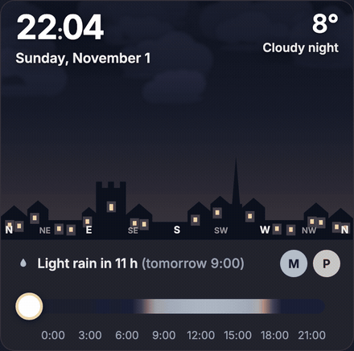
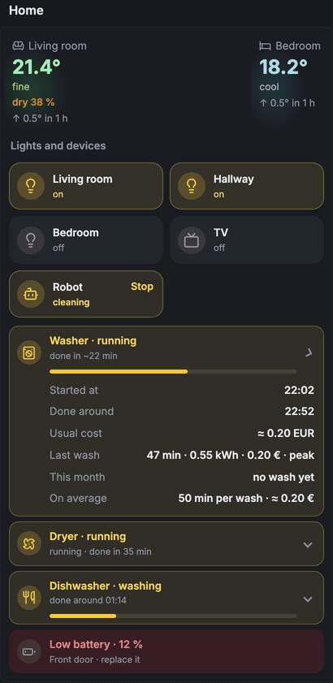

# dashboard: Home and Media pages for Glance

Two [Glance](https://github.com/glanceapp/glance) pages built from `custom-api` widgets fed by small Python
collectors. **Home** has an animated sky with a rain alert, a to-do card, quick buttons, an agenda grouped by day,
a Home Assistant card (rooms, lights, robot vacuum, washer / dryer / dishwasher with a "running" effect) and a meter
readings form. **Media** is an IMDb-app style page over Jellyfin, Sonarr, Radarr and Jellyseerr.

The NAS page is a separate module: [../nas-tab](../nas-tab).

<p align="center">
  
  &nbsp;
  
</p>

## Why this exists

The phone is the one screen that is always with me, so the dashboard was built for it first: one page to open in the
morning and know everything at a glance (weather, what needs doing, what is running at home), without opening five
apps. Glance was a good base because a `custom-api` widget is just a template over JSON, so anything can become a card.

A few choices behind it:

- **Actions, not numbers.** The To do card only lists things to do now (start the robot, water the plants, file 3
  documents), with the button right there. When there is nothing to do, the card disappears.
- **Small Python scripts write JSON, Glance only displays it.** The page stays fast, a broken API never breaks the
  page, and every script can be tested on its own with `--print`.
- **Buttons that tell the truth.** A tap shows "✓" only once Home Assistant actually answered, otherwise "not sent ·
  retry". Nothing is worse than a button that looks like it worked.
- **A bit of life.** The sky follows the real sun, Moon and clouds, the washer shakes while it runs, the dishwasher
  bubbles. Small touches, but they make you want to open it.

## Requirements

- Glance (tested with 0.8.x), with an assets folder you can write to from the host
- Python 3.9+ (standard library only), cron
- Home Assistant with a long-lived token (Home page)
- Optional: Jellyfin, Sonarr, Radarr, Jellyseerr/Overseerr, an OMDb key (Media page); Paperless-ngx, Mealie (to-do count, grocery badge)
- A reverse proxy in front of Glance if you want the buttons to confirm that Home Assistant received the order (Caddy snippet below)

## Install

1. Copy `assets/*` into the Glance assets folder (the one mounted on `/app/assets`).
2. Copy `scripts/` somewhere on the host, copy `config.example.env` to `scripts/config.env` and fill it in.
3. Run each script once with `--print` (where supported) to check, then once without to create `<assets>/data/*.json`.
4. Install the cron jobs: `cron.example` -> `/etc/cron.d/glance-dashboard` (adjust paths).
5. Home Assistant: copy `homeassistant/dashboard_package.yaml` to `/config/packages/`, rename the example entities,
   put three long random webhook ids in it, add `seerr_api_key`, `sonarr_api_key`, `radarr_api_key` to `secrets.yaml`, restart.
6. Merge `glance.example.yml` into your Glance config and give the Glance container the environment variables listed at
   the bottom of `config.example.env` (`DATA_URL`, `HA_URL`, `HA_TOKEN`, webhook ids, public URLs, `CURRENCY`).
7. Edit the entity ids at the top of the Home card template, and the shortcut URLs.

### Caddy snippet (reliable buttons)

Forms in the templates post to `HA_URL/api/webhook/<id>`. `assets/webhooks.js` rewrites them to a same-origin
`/ha-webhook/<id>` route so the page can read the answer ("✓" only when HA answered, "not sent · retry" otherwise).
Without this route the forms still work (fallback to a plain post), you just lose the confirmation.

```
glance.example.lan {
    handle_path /ha-webhook/* {
        # same auth as Glance itself if you use forward auth
        rewrite * /api/webhook{uri}
        reverse_proxy homeassistant.local:8123
    }
    reverse_proxy glance:8080
}
```

## Widgets

| Widget | What it shows | Script (cron) | Home Assistant entities |
|---|---|---|---|
| Weather (sky) | Canvas drawing of the local sky at the real time: sun and Moon (real phase), bright planets, colours from day to night, drifting clouds, rain/snow/thunder, windows lighting up at dusk, whole horizon. Slider up to +24 h. Rain alert text ("Light rain in 1 h 30 (20:00)"), optional official warning pill. | `weather_hours.py` (*/5) | `weather.*` with hourly forecast (`HA_WEATHER_ENTITY`), `sun.sun` |
| To do | Actions only, most urgent first: items of a HA to-do list with a Done button, robot vacuum not run for N days with a Start button, low batteries, pending HA updates, Paperless inbox count, monthly meter reading. Hidden when empty. | `home.py` (*/5) | `todo.chores`, `vacuum.robot`, `sensor.robot_last_cleaning` (timestamp), battery sensors, `update.*` |
| Tools | Documents button (Paperless search page, [../paperless-search](../paperless-search)) and Groceries button ([../offline-grocery](../offline-grocery)) with the number of items left on the Mealie list. | `home.py` | none |
| Agenda | Next 5 days that have something, day weather (Open-Meteo), "in 2 h 10" / "now" countdown, events of secondary calendars in grey. | `agenda_days.py` (*/5) | `calendar.*` (`AGENDA_CALENDARS`) |
| Home | Room temperature tiles (colour from cool to warm, humidity, 1 h trend); light/TV/robot tiles that toggle through a webhook (robot asks for a second tap); washer, dryer, dishwasher with progress bar, end time, last cycle, this month and average cost; lowest battery. | `home.py`, `appliance_stats.py` (*/5) | `light.living_room`, `light.hallway`, `switch.bedroom_lamp`, `remote.living_room_tv`, `vacuum.robot`, `sensor.robot_battery`, `sensor.robot_cleaning_progress`, `binary_sensor.washer_running` / `dryer_running` / `dishwasher_running`, `sensor.dishwasher_power`, `input_number.*_end_ts` / `*_emptied_ts` / `dishwasher_start_ts`, `sensor.*_last`, optional `sensor.dryer_time_to_end` (minutes); temperature sensors in `ROOMS` |
| Meters | Monthly consumption per meter with a sparkline and a comparison, reading reminder, form to type the indexes (checked before sending: empty or lower than the current index is refused). | `meters.py` (*/5) | `input_number.meter_<key>`, `sensor.meter_<key>` (statistics), `input_text.meter_last_reading` |
| Shortcuts | Static links in groups. | none | none |
| Continue watching | The last title played in Jellyfin, backdrop, progress, time left, rating. | `media.py` (*/10) | none |
| Search | Search box to Jellyseerr + genre chips. | none | none |
| Trending / Discover | Poster rows (trending, movies in cinemas soon, upcoming series, anime) with IMDb rating, "in your library" check and a "+" ribbon that requests the title. | `media.py`, `ratings.py` (every 6 h) | none (webhook) |
| Downloads | Sonarr/Radarr queue grouped per movie / season, readable reason when an import is blocked, "Delete and search another version" button, what arrived in the last 2 h. | `downloads.py` (*/2) | none (webhook) |
| Your requests | Jellyseerr requests not arrived yet, ordered by expected arrival (downloading, waiting, release date). | `media.py` | none |
| This week | Episodes of your series and digital movie releases per day, then "Later". | `media.py` | none |
| New in the library | Jellyfin items added in the last 10 days. | `media.py` | none |
| Series news | TV news from a few RSS feeds, with a "Your series" tab when a headline names one of your Sonarr series. | `media_news.py` (*/30) | none |

Assets: `live.js` refreshes widgets every minute without reloading the page (leaves interactive widgets, open
`<details>` and scroll positions alone, shows a banner when the page is stale); `webhooks.js` makes webhook buttons
reliable; `icons.js` swaps emojis for Lucide icons (`icons.svg`); `sky.js/css` the sky; `agenda.js/css`;
`home.css`, `media.css`, `fonts.css`, `user.css` the theme.

## Configuration

All script settings are in `config.example.env` (commented). The main ones:

| Variable | Used by | Meaning |
|---|---|---|
| `ASSETS_DIR` | all | host path served by Glance as `/assets`; JSON goes to `data/`, images to `posters/` |
| `LAT`, `LON`, `TZ` | weather, agenda | your location and time zone |
| `HA_URL`, `HA_TOKEN` | Home scripts | Home Assistant API |
| `RAIN_RADAR` | weather | `buienradar` (Benelux only) or `none` |
| `METEOALARM_FEED`, `METEOALARM_AREAS` | weather | official warnings (optional) |
| `AGENDA_CALENDARS`, `AGENDA_OTHER_CALENDARS` | agenda | calendars, and those shown in grey |
| `ROOMS` | home | `name|temp entity|humidity entity|emoji;...` |
| `TODO_ENTITY`, `VACUUM_*`, `BATTERY_EXCLUDE` | home | to-do sources |
| `PAPERLESS_*`, `MEALIE_*` | home | optional counts |
| `APPLIANCE_LOGS`, `CURRENCY` | appliance_stats | CSV written by Home Assistant |
| `HA_DB`, `METERS`, `METERS_CSV` | meters | HA SQLite database (read-only), meter list, optional older readings |
| `JELLYFIN_*`, `SONARR_*`, `RADARR_*`, `SEERR_*` | media scripts | URLs and API keys |
| `MEDIA_LANGUAGE`, `OMDB_KEY`, `NEWS_FEEDS` | media scripts | title language, ratings, news feeds |
| `HOME_WEBHOOK_ID`, `MEDIA_WEBHOOK_ID` | home, downloads | webhook ids put in the buttons (same as in HA and Glance) |

## How it works

Every script writes one JSON file into `<assets>/data`. Glance fetches it server-side (`DATA_URL`, usually
`http://127.0.0.1:8080/assets/data` from inside the Glance container) and renders it with the templates in
`glance.example.yml`. The sky is the exception: the widget only carries the data in `data-brut`, `sky.js` draws it
and re-reads `/assets/data/weather-sky.json` every 10 minutes (the hidden input stops `live.js` from replacing the canvas).
Buttons are plain HTML forms posting to Home Assistant webhooks; the HA package does the work (toggle a light,
start the vacuum, store meter indexes, request a title in Jellyseerr, remove a download and blocklist it).

## Limitations

- Texts are in English with 24 h times; the Glance templates and scripts would need editing for another language.
- Entity ids are written in the Home card template: rename them there (and in the HA package).
- Data files are served by Glance like any asset: anyone who can open Glance can read them. Keep Glance behind auth.
- Webhooks in Home Assistant need no login; use long random ids and do not expose HA webhooks publicly if you can avoid it.
- `meters.py` reads the HA SQLite database directly; with MariaDB/PostgreSQL recorder it only sees the current index
  (plus `METERS_CSV`).
- The rain radar is Benelux only; elsewhere the alert relies on the hourly forecast.
- The original setup also had a natural-language "+ Add" sheet for the agenda (French parser) and a camera snapshot;
  they are not included.
