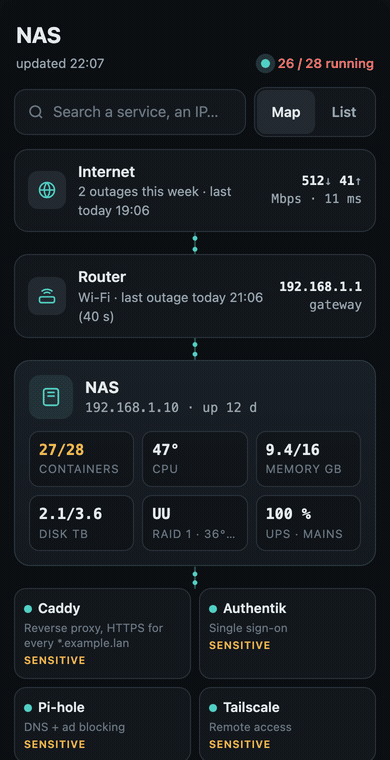

# nas-tab

A "NAS" page for [Glance](https://github.com/glanceapp/glance): a live, read-only status page for a Docker host.
A Python collector runs from cron every minute and writes one JSON file; a small script in Glance draws it.
Built on a UGREEN DXP2800 (UGOS), but it only uses Docker, `/proc`, `/sys` and cron, so any Linux Docker host works.

<p align="center"></p>

## Why this exists

The server runs around fifty containers. When something feels off (a slow film, a notification that never came),
I want the answer from my phone in five seconds, without logging into the NAS admin UI or SSH. This page answers
three questions at once: is everything up, what changed recently, and what is about to run.

The outages block came from real life: the Wi-Fi had short drops that nobody could prove. Logging every drop of
Wi-Fi, internet and power with its duration turned "the internet is bad again" into a 30-day history you can
actually show your ISP (or use to find that it was your own access point).

The scheduled tasks list came from the same need: after a while you forget what cron runs and when. Here they are in
the order they will run, and a tap shows what each script does.

What the page shows:

- **Overall state**: "26 / 28 running" with a pulse, and a map: internet → router → host → entry services → container groups.
- **Host tiles**: containers, CPU temperature, memory, disk, software RAID (`/proc/mdstat`), UPS (NUT), each tile only if the data exists.
- **Container groups**, collapsed by default. Tap a group to expand, tap a container for its sheet (image, version, IP, uptime, CPU/RAM, health, last update, web address, attached databases). Search box and a plain list view.
- **To do**: stopped containers that should run, unhealthy ones, available updates, old backup, disk almost full, degraded RAID, UPS on battery, hot CPU.
- **Outages · 30 days**: Wi-Fi / internet / power, with counts, a 30-day strip and a per-day history. Each source is optional.
- **Recent updates**: detected from image ID changes, so it works with Watchtower, `docker compose pull`, or anything else.
- **Backup & power**: last Kopia snapshot (or the age of any "last success" file) and UPS state.
- **Scheduled tasks** from `/etc/cron.d`, sorted by next run. Tap one for its description (read from the script header), schedule, last run (from the cron log) and script path.
- **Stale-data banner**: if the JSON stops being refreshed (cron dead, host frozen), the page says so instead of showing old data as current.

## Requirements

- Glance with an `assets-path` (to serve the JS, CSS and JSON).
- Python 3.9+ on the Docker host, no extra packages. Runs as root (or a user that can use `docker` and read the logs).
- Optional: NUT (`upsc`) for the UPS, Kopia in a container, a Caddyfile, Speedtest Tracker, a cron log (`/var/log/cron.log` or syslog).

## Install

1. Copy the collector and its config:

   ```sh
   sudo mkdir -p /opt/nas-tab /var/lib/nas-tab
   sudo cp collector/*.py /opt/nas-tab/
   sudo cp config.example.env /opt/nas-tab/config.env           # then edit it
   sudo cp catalogue.example.json /opt/nas-tab/catalogue.json   # optional, edit it
   sudo cp wifi-ping.example.env /opt/nas-tab/wifi-ping.env     # optional, edit it
   ```

2. Copy `assets/nas.js` and `assets/nas.css` into your Glance assets folder, and set `OUTPUT` in `config.env` to
   `<assets folder>/nas-state.json`.

3. Try it: `sudo python3 /opt/nas-tab/nas-state.py --config /opt/nas-tab/config.env --summary`, then without `--summary`.

4. Add the cron lines from `cron.example` to `/etc/cron.d/nas-state` (and `/etc/cron.d/wifi-ping` if you want Wi-Fi outages).

5. Add the page to `glance.yml` (see `glance.example.yml`): the CSS/JS in `document.head`, then an `html` widget with
   `<div class="nas-app" data-nas-app data-src="/assets/nas-state.json">`. Restart Glance.

`sample-data/nas-state.example.json` is a full example of the JSON, handy to work on the page without a host.

## Configuration

All settings are environment variables, read from `config.env` (or `--config FILE`, or `NAS_TAB_CONFIG`). Real
environment variables win over the file.

| Variable | Default | What |
|---|---|---|
| `OUTPUT` | `./nas-state.json` | JSON file(s) to write, comma-separated |
| `STATE_DIR` | `/var/lib/nas-tab` | cache and update history |
| `HOST_LABEL`, `HOST_IP` | hostname, default-route IP | host node on the map |
| `ISP_LABEL`, `ROUTER_LABEL`, `ROUTER_IP` | `Internet`, `Router`, empty | top nodes on the map |
| `SHORT_IP_PREFIX` | empty | shown as `.` on chips (`192.168.1.` → `.42`) |
| `LAN_PREFIX` | `192.168.` | which container IPs are LAN (macvlan) addresses |
| `CATALOGUE` | `catalogue.json` next to the script | groups and container names, optional |
| `CADDYFILE`, `CADDY_HOST_SUFFIX` | empty | find each container's `https://` address from `reverse_proxy <ip>:<port>` |
| `LOGS_URL` | empty | "Logs" button on the sheet, `{name}` = container name |
| `DB_PATTERN` | `postgres\|redis\|valkey\|mariadb\|mysql\|mongo\|-db$` | containers attached to their compose project's service |
| `UPDATES_FILE` | empty | available updates, see below |
| `DATA_PATH` | `/` | volume for the disk tile (`/volume1` on UGOS/Synology) |
| `DISK_WARN_PCT`, `CPU_HOT_C` | `85`, `85` | "To do" thresholds |
| `UPS_NAME`, `UPS_COMMAND`, `UPS_NOTE` | empty, `upsc {name}`, empty | NUT UPS; the command can be `docker exec nut upsc {name}` |
| `SPEEDTEST_JSON` | empty | file or URL with `download`/`upload` (or `*_bits`) and `ping` |
| `KOPIA_CONTAINER`, `KOPIA_SOURCE` | empty | last snapshot via `docker exec <c> kopia snapshot list <source>` |
| `BACKUP_STAMP_FILE` | empty | or: a file your backup script touches on success |
| `BACKUP_LABEL`, `BACKUP_MAX_AGE_H` | `Backup`, `30` | label and "too old" limit |
| `CRON_DIRS`, `CRON_LOG`, `CRON_IGNORE` | `/etc/cron.d`, `/var/log/cron.log`, `e2scrub_all,php,sysstat` | scheduled tasks |
| `KEY_TASKS` | empty | cron.d file names tagged "key" |
| `WIFI_OUTAGE_LOG`, `WIFI_OUTAGE_STATE` | empty | Wi-Fi outages (from `wifi-ping.py`) |
| `NET_OUTAGE_LOG`, `NET_OUTAGE_STATE` | empty | internet outages |
| `POWER_OUTAGE_LOG` | empty | power cuts |
| `OUTAGE_DOWN_RE`, `OUTAGE_UP_RE`, `OUTAGE_BOOT_RE` | `^DOWN\b`, `^UP\b`, `^BOOT\b` | words in text logs, per type with `NET_`, `WIFI_`, `POWER_` prefix |
| `LINKS` | empty | "Links" block: `Name\|URL;Name\|URL` |

On the page side, `data-stale-after="300"` on the widget sets when the stale banner appears (seconds).

### Container groups

Three ways, mixable:

1. **Catalogue** (`catalogue.example.json`): `groups` in display order (a group with `"entry": true` is drawn as tiles
   right under the host, for the reverse proxy, SSO, DNS...), and `containers` with `container`, `name`, `group`,
   `desc`, optional `url`, `deps` (containers attached to it, like its database), `sensitive` (what breaks when it
   restarts, shown as a warning) and `hidden` (not drawn as an entry tile).
2. **Docker labels** on containers not in the catalogue: `nas-tab.group`, `nas-tab.name`, `nas-tab.desc`, `nas-tab.url`,
   `nas-tab.sensitive`, `nas-tab.hide=true`.
3. **Nothing**: every container goes to "Other", and databases are attached to the service of their compose project.

### Outage logs

Each type (Wi-Fi, internet, power) reads its own optional log. Two line formats are accepted, even mixed:

```
{"start": "2026-11-01T21:05:10", "seconds": 40, "gateway": true, "note": ""}     # JSON lines (wifi-ping.py)
2026-11-01 21:05:10 DOWN ping 1.1.1.1 failed                                      # text: start
2026-11-01 21:05:50 UP                                                            # text: end
2026-11-01 21:07:00 BOOT                                                          # text: watcher restarted
```

The words are regexes, so an existing log can be read as is, e.g. `POWER_DOWN_RE=on battery`, `POWER_UP_RE=on line power`.
A `*_OUTAGE_STATE` file (`{"start": iso or null, "seen": iso}`) marks an outage still in progress.

`wifi-ping.py` (cron every minute, 6 passes of 10 s) pings a few always-on Wi-Fi devices from the wired host; an
outage is `THRESHOLD` of them silent at once. It also pings the router, to tell "Wi-Fi only" from "router gone".
Point a second copy at public IPs (another config: `WITNESSES=1.1.1.1,9.9.9.9,8.8.8.8`, other state/log files) to log
internet outages the same way.

### Available updates

The collector does not check registries itself. If you have a checker, write its result to `UPDATES_FILE`:

```json
{"items": [{"container": "paperless", "current": "2.13.4", "latest": "2.14.0"}]}
```

## How it works

`nas-state.py` runs `docker inspect` on every run (`docker stats` every 5 min, Kopia every 30 min, the cron scan every
10 min, all cached in `STATE_DIR`), reads `/proc`, `/sys`, `/proc/mdstat`, the cron log and the outage logs, and writes
the JSON atomically. It compares each container's image ID with the previous run to log updates in
`update-history.jsonl`. `nas.js` fetches the JSON every 30 s and redraws, keeping open groups and folded lists as they were.

## Limitations

- Read only on purpose: no restart/update buttons. The original setup had them (through a Home Assistant webhook and a
  whitelisted action script), but that is too tied to one home to share safely.
- Dropped from the original page because they were private or too specific: the alerts journal (it parsed one
  household's notification texts), the outbound traffic watch (iptables counters inside container namespaces),
  Home Assistant integration checks and auto-repair results.
- Recent updates only appear after the collector has seen a container at least once before the update.
- Disk temperatures need the `drivetemp` kernel module; otherwise the RAID tile shows no temperatures.
- Dark theme only, UI strings in English and 24h times.
