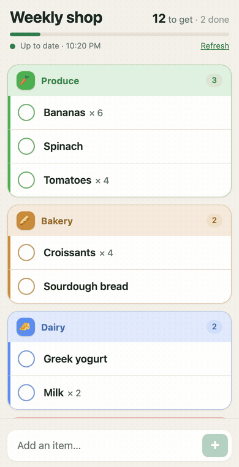

# offline-grocery

An installable grocery list (PWA) for one [Mealie](https://mealie.io/) shopping list that keeps working in the store
with no signal. Check items off and add new ones offline; everything syncs back to Mealie when the network returns.
Optionally, the phone gets a silent Web Push when the list changes in Mealie, so the cached copy is always fresh.

<p align="center"></p>

## Why this exists

Mealie's shopping list is great, until you are in the supermarket with one bar of signal (or none) and the list
simply won't load. That happened often enough to be annoying, so this app keeps a copy of the list on the phone.
You can check items off and add new ones with no network at all; the changes wait on the phone and are sent to
Mealie as soon as it is back online. The list in Mealie stays the single source of truth: recipes, the meal plan
and the rest of the family keep using Mealie as usual.

**In short**

- Opens instantly, even in airplane mode (installable as an app on the home screen)
- Check / uncheck / add items offline, with a "3 to send" counter
- Syncs back to Mealie automatically when the network returns
- Items grouped by aisle, using your Mealie labels and their order
- Optional push so the phone's copy refreshes when someone edits the list

## Requirements

- Mealie 2.x (uses `/api/households/shopping/...` and `/api/groups/labels`) and an API token.
- Docker (or Python 3.10+ with `pywebpush` and `py-vapid` if you run `server.py` directly).
- **HTTPS with a certificate the phone trusts.** Service workers and push only run in a secure context, and Chrome
  refuses to register a service worker on a page with a certificate error. A self-signed / internal CA cert works
  only if the phone trusts that CA. A tailnet-only `tailscale serve` URL (real cert) works well.

## Install

```sh
git clone <this repo> && cd glance-homelab/offline-grocery
cp config.example.env .env                 # fill in MEALIE_URL, MEALIE_TOKEN, MEALIE_LIST_ID
cp catalog.example.json catalog.json       # optional, edit to your items/aisles (or drop that volume line)
docker compose up -d --build
docker logs offline-grocery                # "offline grocery on :8080/grocery/ ..."
```

Then put it behind your HTTPS reverse proxy. Caddy example (keeps the `/grocery` prefix, which the server expects):

```caddy
home.example.lan {
    handle /grocery* {
        reverse_proxy 192.168.1.10:8080
    }
}
```

Open `https://home.example.lan/grocery/` on the phone (with the trailing slash), then:

1. Let it load once with network: the list is now cached.
2. Browser menu, **Install app** / **Add to home screen**.
3. Tap **Enable notifications** if you want the background refresh (optional).

To update after changing files: `docker compose up -d --build`.

## Configuration

Environment variables (`.env`):

| Variable | Default | Meaning |
| --- | --- | --- |
| `MEALIE_URL` | `http://mealie:9000` | Mealie base URL, as reachable from the container. |
| `MEALIE_TOKEN` | required | Mealie API token. Stays on the server, never sent to the phone. |
| `MEALIE_LIST_ID` | required | UUID of the shopping list (last part of the list URL in Mealie). |
| `BASE_PATH` | `/grocery` | URL prefix the app lives under. `/` to serve at the root. |
| `POLL_INTERVAL` | `120` | Seconds between checks of the Mealie list (for push). |
| `VAPID_SUBJECT` | `mailto:admin@example.com` | Contact sent to push services. Put a real address. |
| `ADDED_NOTE` | `added from phone` | Text appended to the note of items added from the app (`Name  ·  added from phone`). Empty = nothing. |
| `OTHER_AISLE` | `Other` | Section name for items without a label. |
| `AISLE_ICONS` | small built-in English map | JSON object `{"label name": "emoji"}` for section icons. |
| `CATALOG` | `/config/catalog.json` | Optional item catalog, see below. Missing file = no suggestions. |
| `DATA_DIR` | `/data` | VAPID keys, push subscriptions, last seen list version. |
| `PORT` | `8080` | Listen port. |

### Item catalog (optional)

`catalog.json` lists items you buy often:

```json
{"items": [{"name": "Milk", "aisle": "Dairy", "keywords": "semi-skimmed"}]}
```

It feeds the suggestion chips while typing (also offline, it is cached on the phone), normalises what you type
("milk" becomes "Milk"), and puts new items in the right section: `aisle` must match a **label name in Mealie**.

## How it works

- `server.py` (stdlib HTTP server) serves `static/` and a tiny API under `BASE_PATH`:
  `GET api/list`, `GET api/catalog`, `GET api/vapid`, `GET api/health`, `POST api/ops`, `POST api/subscribe`, `POST api/test-push`.
- `api/list` returns the Mealie list flattened and sorted by your label order (Mealie's shopping list label settings),
  with a short hash as `version`.
- The page keeps the list and a queue of pending operations (`check` / `add`) in the Cache API. Your taps apply
  instantly on top of the cached list; the queue is posted to `api/ops` as soon as possible, replayed in order on the
  server, and the fresh list comes back in the same response. If the page is closed before that, Background Sync lets
  the service worker send it later (Chrome/Android).
- Adding an item that already exists unchecked is a no-op ("already on the list"); if it exists checked, it is unchecked
  instead of duplicated.
- A background thread polls Mealie every `POLL_INTERVAL` seconds. When the hash changes, it sends a Web Push to every
  subscribed device. The service worker refetches the list, and shows a silent notification only if the app is not
  visible. VAPID keys are generated on first start into `DATA_DIR`; expired subscriptions (404/410) are dropped.
- POSTs must be `application/json` and, when the browser sends `Origin`, come from the same host: a basic guard against
  other sites posting to it.

Test push from the phone's browser console, or: `curl -X POST -H 'Content-Type: application/json' -d '{}' https://home.example.lan/grocery/api/test-push`.

## Limitations

- No authentication of its own: anyone who can reach it can read and edit that one list. Keep it on your LAN / VPN,
  or behind your proxy's auth (if you use forward auth, an expired session will make background sync fail quietly).
- One shopping list per container. Run a second container for a second list.
- Conflicts are "last write wins": an item checked offline is sent as checked even if someone unchecked it meanwhile.
- Polling, not webhooks: push lags Mealie by up to `POLL_INTERVAL`.
- Background Sync and Periodic Sync are Chromium-only; on iOS / Firefox the queue is sent next time the app is opened.
  Web Push on iOS needs the app installed to the home screen (iOS 16.4+).
- Quantities, units and foods are displayed but cannot be edited in the app; use Mealie for that.
- UI text is English only.
