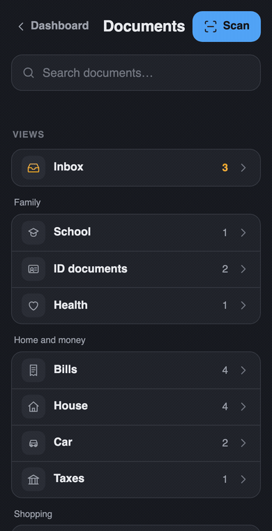

# paperless-search

A small set of static, phone-first pages for [Paperless-ngx](https://docs.paperless-ngx.com/): search that opens the PDF
right away, your saved views as a list, an "Expiring soon" block, a quick inbox triage, and a scan page that turns a few
phone photos into one PDF. No backend and no API token: the pages are served on the same host as Paperless and reuse the
browser's existing Paperless session.

<p align="center"></p>

## Why this exists

Paperless-ngx is great at storing and OCR-ing everything. On a phone, though, the one thing you do most ("where is
that insurance letter?") was clumsy: the search UI is heavy on a small screen, a result opens a details page instead of
the document, and Android won't show a PDF inline. Sometimes the search just didn't find what I was after.

So this is a single page that does that one job well: type a word, see the matching sentence highlighted, tap, read
the PDF. Since every scan, mail attachment and receipt already ends up in Paperless, one fast search on top of it means
all the household paperwork really lives in one place, reachable from the dashboard in one tap.

**In short**

- Search that opens the PDF right away, with the matching words highlighted
- Your saved views as a simple list, with counts
- "Expiring soon": passports, insurance, warranties, from a date custom field
- Inbox triage in two taps: check what Paperless guessed, then **Looks good** or **Fix**
- A scan page: a few phone photos become one PDF, uploaded to Paperless

## Pages

| Page | What it does |
| --- | --- |
| `documents.html` | Main page. Search (full text, falls back to title/content match), saved views grouped with document counts, "Expiring soon", "Recently added", in-page PDF viewer (pdf.js, works on Android where the browser won't show a PDF inline). |
| `documents.html?inbox=1` | Inbox triage. Lists documents carrying an inbox tag with what Paperless guessed (correspondent, type, tags, date). **Looks good** removes only the inbox tag(s), **Undo** puts them back, **Fix** opens the document in Paperless. |
| `index.html` | Minimal search page (`?q=...`), light/dark. Handy as a search target from a dashboard. |
| `viewer.html?id=N` | Standalone PDF viewer for one document. |
| `scan.html` | Take one photo per page (or pick photos / a PDF), merged client-side into a single PDF with jsPDF and uploaded via `post_document`. |

## Requirements

- Paperless-ngx 2.x (uses `saved_views`, `custom_fields`, `is_inbox_tag`, `bulk_edit`, `post_document`).
- A reverse proxy that can serve static files **on the same host name as Paperless** (example below uses Caddy).
- Users log in to Paperless normally in their browser; the pages piggyback on that session.
- Internet access from the browser for pdf.js / jsPDF from cdnjs, unless you self-host them (see below).

## Install

1. Copy this folder somewhere your reverse proxy can read it, e.g. `/srv/paperless-search`.
2. `cp config.example.js config.js` and edit it (all keys optional, see the table).
3. Add the static route to the Paperless site. Caddy (`Caddyfile.example`):

   ```caddy
   paperless.example.lan {
       redir /search /search/
       handle_path /search/* {
           root * /srv/paperless-search
           file_server
       }
       handle {
           reverse_proxy 192.168.1.10:8000
       }
   }
   ```

   Reload Caddy, then open `https://paperless.example.lan/search/documents.html`.
4. Optional, link it from Glance. For example a search bang:

   ```yaml
   - type: search
     bangs:
       - title: Paperless
         shortcut: "!p"
         url: https://paperless.example.lan/search/documents.html?q={QUERY}
   ```

   or plain links to `/search/documents.html`, `/search/documents.html?inbox=1` and `/search/scan.html`.

### pdf.js and jsPDF

By default they load from cdnjs, pinned: pdf.js **3.11.174** and jsPDF **2.5.1**. pdf.js is only fetched when a
document is opened. 3.11.174 is the last pdf.js line that ships a classic `pdf.min.js` exposing `window.pdfjsLib`
(4.x is ES modules only), so stay on 3.x unless you also change the loader in `common.js`.

To self-host instead (LAN without internet, or you just prefer it):

```sh
mkdir -p /srv/paperless-search/vendor
cd /srv/paperless-search/vendor
curl -fLO https://cdn.jsdelivr.net/npm/pdfjs-dist@3.11.174/build/pdf.min.js
curl -fLO https://cdn.jsdelivr.net/npm/pdfjs-dist@3.11.174/build/pdf.worker.min.js
curl -fLO https://cdn.jsdelivr.net/npm/jspdf@2.5.1/dist/jspdf.umd.min.js
```

then in `config.js`: `pdfjsBase: "./vendor/"` and `jspdfUrl: "./vendor/jspdf.umd.min.js"`.
(The official GitHub release zip only contains the non-minified `pdf.js` / `pdf.worker.js`; those work too if you rename them.)
`scan.html` also loads the Inter font from Google Fonts; remove that `<link>` if you don't want it, it falls back to system fonts.

## Configuration (`config.js`)

| Key | Default | Meaning |
| --- | --- | --- |
| `backUrl` | `""` | Link shown top-left on `documents.html` / `scan.html` (your dashboard). Empty hides it. |
| `backLabel` | `"Back"` | Text of that link. |
| `locale` | `null` | Locale for dates (`"en-GB"`, `"de-DE"`...). `null` = browser locale. |
| `pdfjsBase` | cdnjs pdf.js 3.11.174 | Folder URL holding `pdf.min.js` and `pdf.worker.min.js`. |
| `jspdfUrl` | cdnjs jsPDF 2.5.1 | URL of `jspdf.umd.min.js`, used by `scan.html`. |
| `expiryField` | `"Expiry date"` | Name (case-insensitive) or numeric id of a **Date** custom field. Documents with that date in the window show under "Expiring soon". Empty/`null` hides the block; a name that doesn't exist hides it too. |
| `expiryWindowDays` | `120` | Show documents expiring within this many days (expired ones are always shown). |
| `expiryMax` | `6` | Max rows in "Expiring soon". |
| `viewGroups` | `[]` | `[["Group title", ["view name", ...]], ...]`. Saved views are matched by name, case-insensitive, emojis and punctuation ignored. Anything not listed goes to "Other". |
| `viewIcons` | `{}` | `{"view name": "icon"}`. Icons: `doc school gift invoice ticket work home car taxes health id holiday`. |
| `searchPlaceholder` | `"Search documents…"` | Hint in the search field. |

Nothing is hard-coded by id: inbox tags are read from Paperless (`is_inbox_tag`), the expiry field is looked up by name,
correspondents/types/tags are fetched by name for display. The inbox saved view is recognised by its filter (it filters
on an inbox tag) or by having "inbox" in its name; it always appears first and opens the triage mode.

## How it works

- Every request is a plain `fetch("/api/...", {credentials: "same-origin"})`. Since the pages live on the Paperless
  origin, the session cookie goes along and Paperless' normal permissions apply. A 401/403 shows "open Paperless and log in".
- Writes (`bulk_edit`, `post_document`) send the `X-CSRFToken` header from Paperless' `csrftoken` cookie. If the cookie is
  missing or stale, the page loads `/` once so Paperless sets a fresh one, then retries.
- Saved views are converted to API filters for the common rule types (title/content contains, correspondent, document
  type, tags all/any/none, title+content). A view using any other rule type opens in Paperless itself instead.
- The viewer fetches `/api/documents/<id>/preview/` and draws each page on a canvas with pdf.js; image documents are
  shown as images. Back button / Escape closes it.
- Triage uses `bulk_edit` with `modify_tags`, removing only the inbox tag ids the document had. Undo re-adds exactly those.

## Limitations

- Must be on the same host as Paperless. A different subdomain won't work (no CORS, no cookie).
- No login form of its own. If Paperless sits behind SSO / forward auth, users need to have gone through it in that browser.
- If you have a Paperless workflow triggered on "Document updated", "Looks good" will fire it (it is a normal tag edit).
- The triage list shows the latest 100 inbox documents; search shows 25 (documents page) or 100 (index page) results, no paging.
- View counts cost one small API call per saved view on each landing load.
- `documents.html` and `scan.html` are dark-only; `index.html` and `viewer.html` follow the system theme.
- Scan quality: photos are downscaled to 1800 px on the long side, JPEG 82 %, no deskew or cropping. Paperless OCR does the rest.
